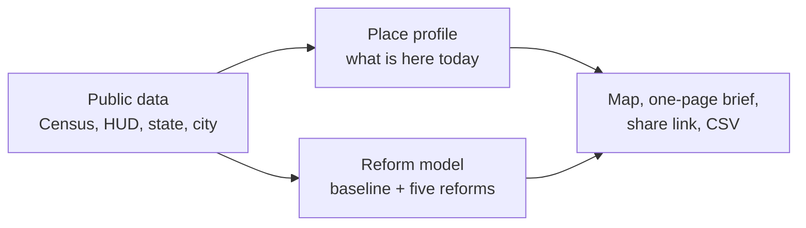

# VisionHousing

**See what a housing reform would build — and what is already on the ground.**

VisionHousing is an open-source map tool for Pennsylvania. It answers two questions:

1. **What if the state changed the rules?** Allow backyard homes, small apartment buildings, more homes near transit, fewer parking minimums, or lower development fees: how many more homes would be permitted over the next five years, and where?
2. **What is this place like today?** For any county or census tract: who lives there, the homes, jobs and employers, what is being built, zoning, plans, tax-credit areas, safety and who is buying. (Some of these sections are still being built.)

Every answer is a likely range, not a single guess. Every number shows where it came from.



## Who it is for

| You are | You come with | You leave with |
|---|---|---|
| A legislator or staffer | "If we pass this, how many homes, and where?" | A range, the main reasons, and the limits, on one screen |
| A planner | "What does this mean for my county?" | County results and a printable place profile |
| A developer or investor | "What is going on in this market?" | Demographics, jobs, pipeline, zoning and incentives in one page |
| A reporter or advocate | "Which reform does the most?" | A side-by-side comparison and a short brief |

## Run it

You need [uv](https://docs.astral.sh/uv/), Node 22 and `make`. No key is required.

```
make setup            # install everything
make data STATE=PA    # download public data and build the Pennsylvania pack
make app              # open http://localhost:8000
```

Working on the interface? `make dev` gives live reload at http://127.0.0.1:5173.
To publish a no-server copy (for example on Vercel), run `make export-static STATE=PA` and commit `web/public/data/`.

`make verify` runs the checks: lint, tests, licence audit and secret scan. `make help` lists everything else.

## How to trust it

- **Ranges, not forecasts.** Results come from thousands of simulated runs. The spread is shown.
- **Nothing typed by hand.** Every number on screen is computed from fetched public data and the assumptions in [`assumptions/`](assumptions/).
- **Every number can be traced.** Each one links to its formula, its inputs and its sources.
- **No AI inside the tool.** The tool calls no AI model. An AI coding assistant wrote the code under review; see [`DISCLOSURES.md`](DISCLOSURES.md).
- **Limits are stated.** The outcome is homes authorized by building permits, not homes finished. Five years only. No parcel-level predictions.

## Learn more

| Read | For |
|---|---|
| [User guide](docs/USER_GUIDE.md) | Using the screens, sharing and exporting |
| [Model and assumptions](docs/MODEL_AND_ASSUMPTIONS.md) | How the numbers are made, and what the model cannot tell you |
| [Reform comparison](docs/POLICY_SCENARIO_COMPARISON.md) | A short, non-technical comparison of the five reforms |
| [Data provenance](DATA_PROVENANCE.md) | Every dataset, its publisher and licence |
| [Challenge checklist](docs/COMPLIANCE.md) | Each requirement and where it is met |
| [Code notes](docs/modules/README.md) | One plain-language note per module |

## Licence

Apache 2.0 — see [`LICENSE`](LICENSE). Data keeps its publishers' terms, listed in [`DATA_PROVENANCE.md`](DATA_PROVENANCE.md).
