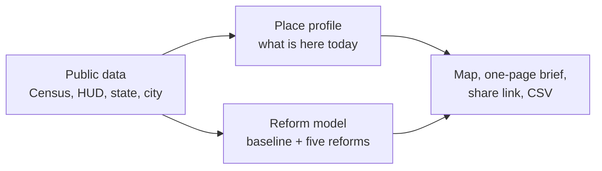

# VisionHousing

**See what a housing reform would build — and what is already on the ground.**

VisionHousing is an open-source map tool for Pennsylvania, with Vermont run on the same code to show how it works where data is thin. It answers two questions:

1. **What if the state changed the rules?** Allow backyard homes, small apartment buildings, more homes near transit, fewer parking minimums, or lower development fees: how many more homes would be permitted over the next five years, and where?
2. **What is this place like today?** For any county or census tract: who lives there, the homes and what they cost, jobs, what is being built, zoning and plans, water and sewer, flood risk, tax-credit areas, safety and who is buying. (Some sections need local data and cover Pennsylvania only.)

Every answer is a likely range, not a single guess. Every number shows where it came from.

**Try it online:** TODO(Ye): add the hosted demo address here once the static site is live. <!-- TODO(Ye): replace this line with the Vercel URL; it needs no account and runs without a server. -->



## Who it is for

| You are | You come with | You leave with |
|---|---|---|
| A legislator or staffer | "If we pass this, how many homes, and where?" | A range, the main reasons, and the limits, on one screen |
| A planner | "What does this mean for my county?" | County results and a printable place profile |
| A developer or investor | "What is going on in this market?" | Demographics, jobs, pipeline, zoning and incentives in one page |
| A reporter or advocate | "Which reform does the most?" | A side-by-side comparison and a short brief |

## Run it

You need [uv](https://docs.astral.sh/uv/) (it installs Python 3.12, pinned in `.python-version`), Node 22.12 or later, and `make`. No key is required. An optional `CENSUS_API_KEY` only makes the survey download faster; the numbers are the same. An optional `API_DATA_GOV_KEY` adds FBI crime counts to the place profile.

One command does everything (install, download and build the Pennsylvania pack, run every check, then serve the tool):

```
make all
```

Or step by step:

```
make setup            # install everything
make data STATE=PA    # download public data and build the Pennsylvania pack
make app              # open http://localhost:8000
```

**How long `make data` takes, and how much disk it needs (approximate).** For Pennsylvania the downloads kept on disk come to about 100 MB, and the finished pack in `data/packs/PA/` to about 10 MB. Some national files are downloaded whole and deleted once the state's rows are taken, so leave at least 2 GB free. The installed tools take about 400 MB more (`.venv/` and `web/node_modules/`). A first run usually takes tens of minutes, depending on your connection and on the publishers' servers. Files already downloaded are reused, so a second run works offline. <!-- TODO(Ye): time one first run on a fresh clone and put the minutes here. -->

**Massachusetts only (optional).** A few Massachusetts files on www.mass.gov (the MBTA Communities status lists and the state's ADU survey) refuse scripted downloads, and the build respects that. To include them, open each address listed in `assumptions/ma_intake.yaml` in a browser and save the file under the name given there (for example `data/raw/local/ma/mbta3a_compliance_status.csv`). Without them `make data STATE=MA` still finishes, with those tables left out or thinner, and its build notes say which. Pennsylvania and Vermont need no manual step. Details: [`docs/modules/ma_intake.md`](docs/modules/ma_intake.md).

Working on the interface? `make dev` gives live reload at http://127.0.0.1:5173.
To publish a no-server copy (for example on Vercel), run `make export-static STATE=PA` and commit `web/public/data/`.

Run the tests: `make test` (offline, on a small built-in synthetic state; no download needed).

`make verify` runs every check: lint, the tests, the licence audit, the secret scan, `make docs` (the generated tables in the documents match their records) and `make sbom-check` (the software bill of materials in `sbom/` matches the lockfiles). `make help` lists everything else.

## How to trust it

- **Ranges, not forecasts.** Results come from thousands of simulated runs. The spread is shown.
- **Nothing typed by hand.** Every number on screen is computed from fetched public data and the assumptions in [`assumptions/`](assumptions/).
- **Every number can be traced.** Each one links to its formula, its inputs and its sources.
- **No AI inside the tool.** The tool calls no AI model. An AI coding assistant wrote the code under review; see [`DISCLOSURES.md`](DISCLOSURES.md).
- **Limits are stated.** The outcome is homes authorized by building permits, not homes finished. Five years only. No parcel-level predictions.

## Learn more

| Read | For |
|---|---|
| [User guide](docs/USER_GUIDE.md) | Using the screens, sharing and exporting |
| [Model and assumptions](docs/MODEL_AND_ASSUMPTIONS.md) | How the numbers are made, and what the model cannot tell you |
| [Technical appendix](docs/TECHNICAL_APPENDIX.md) | The full assumption tables, validation work and notes for each state |
| [Reform comparison](docs/POLICY_SCENARIO_COMPARISON.md) | A short, non-technical comparison of the five reforms |
| [Data provenance](DATA_PROVENANCE.md) | Every dataset, its publisher and licence |
| [Challenge checklist](docs/COMPLIANCE.md) | Each requirement and where it is met |
| [Code notes](docs/modules/README.md) | One plain-language note per module |

## Licence

Apache 2.0 — see [`LICENSE`](LICENSE). We chose it because it is permissive and carries an explicit patent grant, so public agencies, researchers and companies can reuse and adapt the code on clear terms. Data keeps its publishers' terms, listed in [`DATA_PROVENANCE.md`](DATA_PROVENANCE.md).
